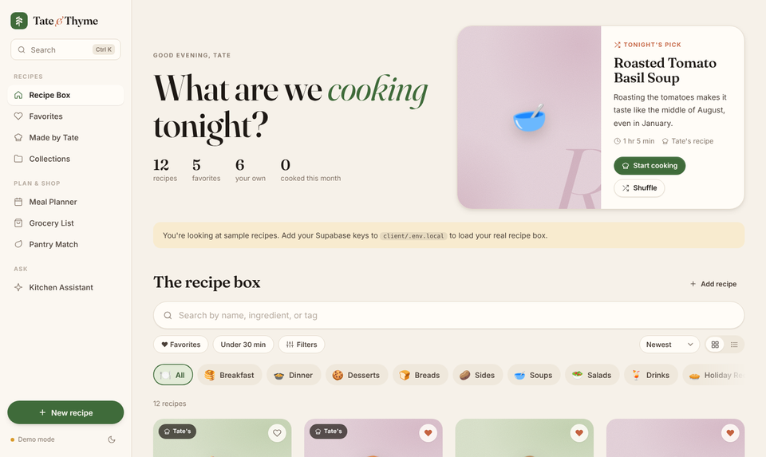

# Tate & Thyme

A personal recipe box for the recipes Tate makes and the ones worth keeping from everywhere else. Plan the week, shop by aisle, cook hands-free, and ask a kitchen assistant that knows every recipe in the box.



## Features

- **Recipe box** with instant ranked search, category rail, filters, sort, grid or list view, and a ⌘K command palette.
- **Recipe pages** that scale servings, convert between US and metric, check off ingredients and steps, and turn times like "bake 25 minutes" into tap-to-start timers.
- **Cook mode**: full-screen, one step at a time, with mise en place, the ingredients each step uses, floating timers, read-aloud, voice commands ("next", "repeat", "start timer"), swipe, and a screen that stays awake.
- **Cook journal**: log each time you make something with a rating, notes and photos.
- **Meal planner**: a week view with drag to rearrange and "Fill my week" suggestions.
- **Grocery list**: built from recipes or the week's plan, with quantities combined and items sorted by aisle.
- **Pantry match**: enter what you have and see what you can make now or with a couple of extra ingredients.
- **Collections**: your own collections, plus smart collections that fill themselves (quick weeknights, made by Tate, never cooked).
- **Kitchen assistant**: chat about scaling, swaps and plans, grounded in your own recipes.
- **AI import**: paste a link or snap a cookbook page to fill in the recipe form.
- Light and dark themes, installable as a home-screen app, and built for phones.

## Running it

```bash
npm install && npm install --prefix client && npm install --prefix server
npm run dev   # client on :5173, API on :3001
```

With no configuration, the app runs in **demo mode**: 12 sample recipes, saved in your browser.

### Supabase (your real recipe box)

Create `client/.env.local`:

```
VITE_SUPABASE_URL=...
VITE_SUPABASE_ANON_KEY=...
```

Run `supabase/schema.sql` in the Supabase SQL editor. The `app_state` table at the end is optional; it syncs collections, the meal plan, the grocery list and the cook journal across devices. Without it they are kept in the browser.

### Claude (assistant and import)

Create `server/.env`:

```
ANTHROPIC_API_KEY=...
```

Without a key, everything else works and the assistant explains how to turn it on.

## Stack

React 18, Vite, TypeScript and CSS Modules on the client; Express and the Anthropic SDK on the server; Supabase for storage. Fonts (Fraunces and Inter) are self-hosted.
